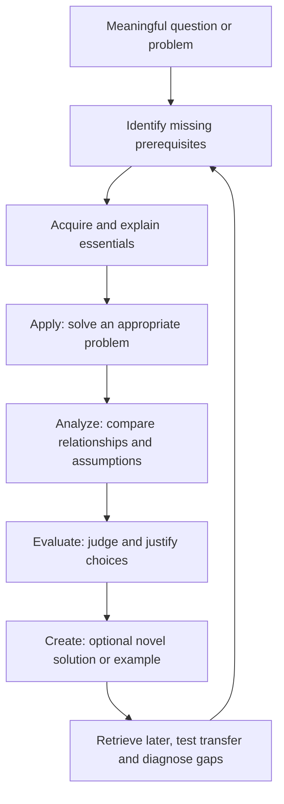
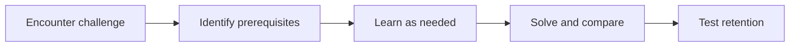
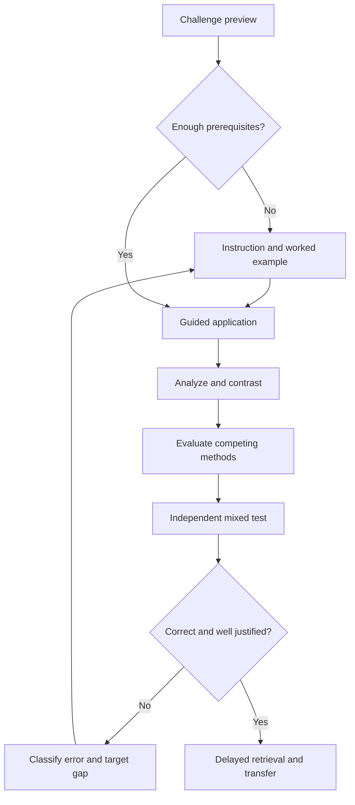

# Bloom's Taxonomy and Higher-Order Learning

> **Central design principle:** Begin learning with an authentic question or problem, use it to motivate the relevant knowledge, and deliberately practice applying, analyzing, and evaluating ideas. Check recall and understanding rather than assuming they emerge automatically.

## Contents

1. [What the transcript actually argues](#1-what-the-transcript-actually-argues)
2. [The six levels](#2-the-six-levels)
3. [Why sequencing matters](#3-why-sequencing-matters)
4. [The operational protocol](#4-the-operational-protocol)
5. [How to write good questions](#5-how-to-write-good-questions)
6. [Math example: monotone convergence](#6-math-example-monotone-convergence)
7. [Integrating the existing four methods](#7-integrating-the-existing-four-methods)
8. [Limitations and critical analysis](#8-limitations-and-critical-analysis)
9. [AI tutor operating instructions](#9-ai-tutor-operating-instructions)
10. [Tracking and improvement](#10-tracking-and-improvement)
11. [Reusable templates](#11-reusable-templates)
12. [Transcript reference map](#12-transcript-reference-map)

## 1. What the transcript actually argues

The speaker uses the **revised Bloom's taxonomy** as a practical lens for planning study. The six categories are remember, understand, apply, analyze, evaluate, and create. He says learners should concentrate more on the **apply–analyze–evaluate** range rather than spending most of their time on memorizing and basic comprehension. He stresses examining relationships, comparing concepts, judging their relative importance in context, and **framing a problem or higher-order goal before learning details**. He permits flashcards for material requiring memorization and says creating original research is not required for an exam.

**Source-derived assertions, not verified facts:** The speaker says relational learning automatically makes lower-order learning easier, asserts that memorization-heavy material usually represents only small percentages of curricula, and argues that problem-first learning is categorically more efficient. These statements are broad and should not be accepted as universal laws.

**Our extension:** Turn his broad ideas into a tutor-led, iterative, measurable protocol with prerequisites, worked examples, retrieval, feedback, and transfer assessments.



## 2. The six levels

These are **types of cognitive processes**, not fixed stages that every learner must pass through linearly. Real tasks can combine multiple levels. The familiar taxonomy pyramid is a pedagogical visualization, not proof that higher categories always produce more learning.

| Level | Core operation | Useful prompt | Evidence of success | Typical pitfall |
|---|---|---|---|---|
| **1 Remember** | Retrieve a fact or statement | What is the formal definition? | Accurate recall without cues | Recognition mistaken for recall |
| **2 Understand** | Explain and interpret | What does this mean in your own words? | Correct explanation and example | Fluent but inaccurate analogy |
| **3 Apply** | Execute a procedure or use a concept | Solve this concrete case | Correct method and result | Only succeeding when method is named |
| **4 Analyze** | Relate parts, inspect assumptions and differences | Which conditions distinguish these cases? | Explicit links, comparisons, counterexamples | Superficial side-by-side lists |
| **5 Evaluate** | Critique or choose using criteria | Which method is preferable here, and why? | Context-dependent, justified judgment | Unargued preferences |
| **6 Create** | Assemble an original-to-learner product or solution | Can you devise a new counterexample or proof? | Coherent novel construction, checked for correctness | Mistaking arbitrary novelty for quality |

**Math example (one central concept: sequence convergence):**

1. **Remember:** State the epsilon–N definition of convergence.
2. **Understand:** Explain why terms eventually remain within any chosen tolerance of the limit.
3. **Apply:** Prove `a_n=1/n` converges to zero.
4. **Analyze:** Compare convergence, boundedness, and monotonicity; identify implications that fail.
5. **Evaluate:** Choose between a direct epsilon–N proof and a convergence theorem for a specific sequence; justify the choice.
6. **Create:** Construct a bounded nonconvergent sequence, or devise an alternative proof.

## 3. Why sequencing matters

### The speaker's contrast

**Concept-first and delayed application**


**Goal-framed learning**



The transcript argues that an early problem makes the relevant relationships visible, gives learning a purpose, and avoids needing to reorganize initially isolated facts later.

### Our refinement: problem-first does not mean guidance-free discovery

A task can orient study without demanding immediate success. Use a **challenge preview**: attempt a small, approachable portion, identify what is unknown, then receive explicit instruction or a worked example. More scaffolding is suitable when prerequisites are weak. Delaying *all* foundational explanation is not necessary or always effective.

**Decision rule:** If the learner cannot identify a plausible first step after a brief attempt, lower the difficulty, supply a subgoal, or teach a prerequisite. Do not mistake unproductive struggle for deeper learning.

## 4. The operational protocol

### Phase 0 — Define the target

Specify the topic, background, why it matters, the target assessment, and desired sophistication. State what the learner should be able to do, not just what chapter to read.

### Phase 1 — Challenge preview (2–5 minutes)

Offer one accessible but meaningful question. Ask for a prediction, rough strategy, or first step. Allow uncertainty. The goal is orientation and diagnosis, **not** an unsupported exam.

### Phase 2 — Prerequisites and focused explanation

Identify missing definitions, representations, or techniques. Teach just enough, with at least one carefully selected worked example if the material is unfamiliar. Check a small fact and a conceptual explanation.

### Phase 3 — Apply

Solve one representative problem, then a nearby variation. Start with support and fade hints. Request a correct method, justification, and answer.

### Phase 4 — Analyze

Use side-by-side examples, labeled concept relationships, boundary cases, counterexamples, and comparison questions. Make the learner say **where the concepts coincide, where they diverge, and which assumptions cause the difference**.

### Phase 5 — Evaluate

Present two plausible techniques or claims. Ask the learner to select one in a specified context, state evaluation criteria, defend the selection, and note when the alternative would be preferable.

### Phase 6 — Optional create

Ask for an original-to-learner example, alternate solution, model, proof, experiment, or explanation. **Optional** for time-constrained topics; not every exam objective needs a creative task.

### Phase 7 — Independent test and retention

Without revealing the method, offer a novel problem and a short free-recall prompt. Check the exact definition, theorem assumptions, and required formulas. Schedule delayed review, with targeted flashcards where they help. Revisit errors rather than repeating everything.



## 5. How to write good questions

An effective question elicits the cognitive process claimed. Merely adding 'why' does not automatically make a question higher-order.

| Goal | Weak prompt | Better prompt |
|---|---|---|
| Remember | 'Does this seem familiar?' | 'State the theorem precisely without notes.' |
| Understand | 'Read the definition again.' | 'Explain each quantifier and produce an example.' |
| Apply | 'Recall the derivative rule.' | 'Differentiate this function and justify which rule applies.' |
| Analyze | 'List related concepts.' | 'Contrast the hypotheses and conclusions of the two theorems; find a counterexample to the invalid converse.' |
| Evaluate | 'Which method is best?' | 'Choose a proof strategy for this problem; compare complexity and assumptions with an alternative.' |
| Create | 'Make something interesting.' | 'Construct a sequence satisfying these three properties, and prove that it does.' |

### Diagnostic error categories

- **R — Retrieval:** theorem name, definition, formula, or prerequisite not available.
- **C — Concept:** can state facts but misinterprets their meaning.
- **A — Application:** knows idea but cannot execute it correctly.
- **D — Discrimination:** chooses wrong concept, confuses similar assumptions.
- **J — Justification:** chooses an answer without a defensible rationale.
- **T — Transfer:** fails when the problem differs from practiced templates.

Match feedback to the error type, not just an overall right/wrong judgment.

## 6. Math example: monotone convergence

**Target problem:** Without being given a limit, how can we guarantee a real sequence converges?

**Challenge preview:** Consider `a_n=1-1/n` for positive integers `n`. Is the sequence increasing? Is it bounded? Could these properties be useful for proving convergence?

**Prerequisites:** monotonicity, upper/lower bounds, convergence, and the monotone convergence theorem (a monotone bounded real sequence converges).

**Apply:** Show `a_n` is increasing, since `a_{n+1}-a_n=1/[n(n+1)] > 0`. Show `0 <= a_n < 1`; apply the theorem. (A direct limit proof can establish the limit is 1.)

**Analyze:** Contrast with `b_n=n`, which is increasing but unbounded, and `c_n=(-1)^n`, which is bounded but not monotone and does not converge. This shows why *both* assumptions matter in that theorem.

**Evaluate:** Explain when the monotone convergence theorem is convenient (e.g. an iteratively defined sequence with an unknown limit) versus a direct limit calculation. Do not confuse proving existence with calculating a limit value.

**Create:** Propose a bounded, increasing, recursively defined sequence and attempt to establish convergence, checking any required invariant bounds.

**Retention:** Recall the theorem and a counterexample for each missing assumption after a delay; attempt a new, mixed problem without the theorem being named.

## 7. Integrating the existing four methods

This module is **a task-design layer** over the methods in Universal Learning Method v1.0, not a replacement for those methods.

| Existing method | How Bloom's framework changes its use | Evidence required |
|---|---|---|
| Mind mapping | Label logical dependencies and rank importance *in a specific context* (analyze/evaluate). | Every important edge can be justified. |
| AI-assisted Feynman | Explain mechanisms, then defend assumptions and answer challenges (understand/analyze/evaluate). | Correct explanation without coaching and successful follow-up. |
| Interleaving | Mix near-neighbor concepts and problem types; require choosing the right approach (apply/analyze/evaluate). | Correct selections on unlabeled tasks. |
| Flashcards | Retain definitions, theorem hypotheses, tiny counterexamples and crisp relationships (remember, plus some understand/analyze). | Accurate delayed retrieval; cards do not substitute for full proofs. |

### A suggested 75-minute session (example, not validated optimal proportions)

- **5 min:** delayed recall of prerequisite knowledge.
- **5 min:** challenge preview and diagnosis.
- **15 min:** focused explanation and a worked example.
- **15 min:** apply with gradually reduced guidance.
- **12 min:** analyze contrasts and update concept map.
- **13 min:** evaluate or Feynman-defend a solution; tutor feedback.
- **10 min:** independent mixed test, flashcard selection, and log.

For a proof-heavy course, extend the independent problem-solving block. For a new conceptual field, increase initial worked examples. No arbitrary fixed allocation should override actual performance.

## 8. Limitations and critical analysis

### Good principles worth preserving

- **Goals influence attention.** Posing an interesting task can make unfamiliar facts easier to organize.
- **Active application exposes gaps.** Being able to explain a theorem is different from independently choosing and deploying it.
- **Contrast is valuable.** Near-confusable concepts merit explicit comparisons and counterexamples.
- **Justification matters.** Evaluation tasks require criteria and reasoning rather than preferences.
- **Knowledge is cumulative.** Earlier foundations should be retrievable when later topics depend on them.

### Claims to treat cautiously

1. **Bloom's taxonomy is not a proven learning-effectiveness ranking.** It organizes objectives. The highest verb in a task does not determine whether it is well taught or retained.
2. **Understanding is not 'low value'.** Deep comprehension is foundational to good application, and the actual cognitive work may be complex even when a task is labeled 'understand'.
3. **Higher-order practice does not make memorization obsolete.** Exact formulas, notation, vocabulary, and theorem conditions can require explicit retrieval and spaced practice.
4. **The speaker's percentages** (roughly 5–10%, 10–15%, ~20% and rarely >20–30% of material needing memorization) are unsourced generalizations in the supplied transcript. Do **not** use them as design quotas.
5. **Problem-first should be calibrated.** Beginners often need prior knowledge, modeling, prompts, and worked examples to avoid overload.
6. **Create does not mean frontier research.** Original-to-the-learner solutions are meaningful and testable; scientific novelty is unnecessary for most study goals.
7. **Measure learning, not intensity or apparent elegance.** A beautiful map, difficult discussion, or complex prompt can still lead to poor independent performance.

## 9. AI tutor operating instructions

Copy this prompt to a new learning session:

> **Role:** You are an expert, rigorous, supportive tutor. Teach the topic using Bloom's revised taxonomy as a question-design framework, with calibrated scaffolding, retrieval, and feedback. Do not treat Bloom levels as a proven ranking of learning effectiveness.
>
> **Topic:** [TOPIC]  
> **Prior knowledge:** [PREREQUISITES]  
> **Goal and assessment:** [WHAT I MUST DO / EXAM STYLE]  
> **Available time:** [TIME]
>
> **Procedure:**
> 1. Begin with an approachable challenge that reveals the purpose of the topic. Ask for a first attempt, not a full discovery without support.
> 2. Diagnose prerequisites; explain and model essential steps if necessary.
> 3. Progress through applying, analyzing and evaluating. Offer creating tasks when they clearly serve the goal.
> 4. Ask one meaningful question at a time. Require my own answers before giving solutions unless I ask to see a worked example.
> 5. Make me compare similar concepts, justify theorem assumptions, and choose methods without revealing them in the question.
> 6. Check precise definitions and theorem conditions using retrieval; propose a small number of well-designed flashcards if relevant.
> 7. Give specific feedback categorized as retrieval, concept, application, discrimination, justification or transfer error. Address weaknesses with targeted follow-ups.
> 8. End with an independent transfer question, a concise concept-map update, and a delayed-review suggestion.
> 9. Distinguish established facts, pedagogical heuristics and unverified claims. For rigorous mathematics, check all statements and proofs rather than endorsing plausible but invalid arguments.

### Mini-prompts by cognitive demand

**Apply:** "Give me an unlabeled problem requiring today's concept, then evaluate each step of my solution."

**Analyze:** "Choose two easily confused concepts from this topic. Ask me to distinguish assumptions, implications, examples and counterexamples."

**Evaluate:** "Present two plausible methods for the same problem. Ask me to select one under explicit criteria and challenge my justification."

**Create:** "Ask me to devise an original-to-me example or proof that satisfies constraints, then rigorously inspect it."

**Retention:** "Ask for one precise definition, one theorem with assumptions, and one counterexample from memory. Do not reveal answers until I attempt them."

## 10. Tracking and improvement

Record results for **independent** performance, not only assisted explanations:

| Measure | Suggested operationalization |
|---|---|
| Prerequisite recall | Number of correct items / total, no hints |
| Explanation accuracy | Correct / incomplete / false with reason |
| Application | % representative problems solved independently |
| Discrimination | % mixed problems with correct method selection |
| Justification | Is each necessary assumption used correctly? |
| Transfer | Success on a genuinely unfamiliar task |
| Delayed retention | Performance after a time gap |
| Efficiency | Active study minutes per independently mastered objective |

**Small iterative improvement cycle:** Choose a topic → log baseline → use the approach → test immediately → test after a delay → diagnose failures → adjust one element (scaffolding, exercise mix, review schedule, mapping load) → repeat. Do not claim a change caused an improvement on the basis of one exam alone.

## 11. Reusable templates

### Session planning template

```markdown
# Session: [topic]
Date:
Target (assessment / real-world task):
Prerequisites:
Challenge preview:
Remember: what facts must be retrievable?
Understand: what meanings must be explained?
Apply: what problem will be solved?
Analyze: what contrasts or dependencies matter?
Evaluate: what choice must be justified?
Create (optional): what could be constructed?
Scaffolding needed:
Independent mixed problem:
Delayed recall items:
```

### Session review template

```markdown
# Session review
Topic:
Active minutes:
Independent accuracy:
What I explained correctly:
What I applied independently:
Comparisons I made:
Reasoned choices I defended:
Errors (R/C/A/D/J/T):
Concept-map connections to revise:
Flashcards to make/repair:
One new transfer task:
Next review date:
One adjustment for the next session:
```

## 12. Transcript reference map

- **0:18–2:36:** Introduction to Bloom's taxonomy and study efficiency.
- **2:37–4:19:** Remember and understand; critique of repetition and isolated recall.
- **4:20–7:32:** Relational knowledge; applying as meaningful use.
- **7:32–9:19:** Analyze, evaluate and create; comparisons and priorities.
- **9:19–12:47:** Main claim that higher-order goals encourage recall and comprehension.
- **12:47–14:30:** Practical study shift; caveat that some memorization is still necessary; approximate percentages.
- **14:30–16:16:** Sequence/order argument: frame the problem early.
- **16:16–17:41:** Focus on comparison and prioritization; change techniques gradually.

---

**Versioning note:** This is a companion to `Universal_Learning_Method_v1.md`. The central change is to frame every learning unit with a target performance and an appropriate challenge, while preserving explicit guidance, practice, retrieval and delayed testing.
