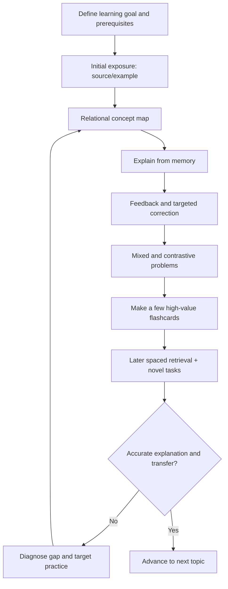

# Universal Learning Method — v1.0

> A working, testable study protocol based on the transcript's three conditionally S-tier approaches (mind mapping, AI-assisted Feynman, concept-focused interleaving), supplemented by retrieval-based flashcards. Designed for later revision; not a claim of a scientifically optimal method.

## Index
1. Source interpretation and evidence
2. Four methods
3. Integrated learning session
4. Review and retention
5. Evaluation and iteration
6. AI tutor prompts
7. Learning record template

## 1. Source interpretation and evidence

**Transcript ratings (the speaker's judgment, not established scientific grades):**
- Mind mapping: D when mechanically drawn; S when it drives active comparison, prioritization, relationship formation and restructuring.
- Feynman technique: A for explaining a concept clearly from memory; S with reliable expert/AI feedback.
- Interleaving: B for classical mixing of subjects; S for the speaker's version emphasizing contrasting related concepts and changing question angles.
- Flashcards: B as retrieval cues paired with spacing; often insufficient alone for complex conceptual reasoning.

**Important limits:** The transcript does not specify a formal algorithm for executing the S-tier methods. Operational steps below are our proposed protocol. 'Concept-focused interleaving' blends classical interleaving with varied retrieval, contrastive learning and transfer tasks; these should not be treated as identical research constructs. Mind mapping can help structure thinking, but is not universally superior to retrieval practice. AI-generated feedback requires verification for high-stakes or formal work.

**Evidence cross-check:** Dunlosky et al. (2013) assessed practice testing and distributed practice as high utility, and interleaved practice as moderate utility under the evidence available then. Karpicke & Blunt (2011) found retrieval practice outperformed elaborative concept mapping on their study's meaningful-learning assessments. See references below.

## 2. The four methods

### 2.1 Relational concept mapping — structure

**Purpose:** Make the subject's concepts, prerequisites, distinctions, causes, implications, and hierarchy explicit.

**Steps:**
1. Define the central question and topic boundaries.
2. List essential concepts from memory first; consult sources to fill gaps.
3. Arrange concepts by foundational status, dependency and scope.
4. Label links using explicit relationships: *requires*, *implies*, *contradicts*, *generalizes*, *is an instance of*, *is used to prove*.
5. Explain each link; seek missing assumptions and counterexamples.
6. Check the map against authoritative source material and correct it.
7. Rebuild its core from memory in a later session.

**Output:** One legible map plus 3–5 core propositions describing the structure.

**Do not:** Copy a polished textbook map without thinking, optimize aesthetics, or create arbitrary unlabeled links.

**Success criterion:** Explain why every major connection exists, identify its limitations, and reconstruct the map's logic without notes.

### 2.2 AI-assisted Feynman — explanation

**Purpose:** Reconstruct conceptual logic in clear language and expose misconceptions.

**Steps:**
1. Select a precisely bounded claim or concept.
2. Explain from memory: intuition, accurate statement, necessary conditions, mechanism or proof outline, example.
3. Have AI challenge accuracy, missing assumptions, hidden circularity, and overgeneralization; verify important judgments using source references.
4. Repair only the diagnosed gap, then re-explain independently.
5. Respond to an unfamiliar follow-up or counterexample challenge.

**Output:** Short explanation in own words, corrected misconceptions, and one new example.

**Do not:** Ask AI to give the full explanation first, confuse accessible explanation with oversimplification, accept every AI correction uncritically.

**Success criterion:** Independently explain accurately, handle probing questions and apply the result to a new instance.

### 2.3 Contrastive/varied interleaved practice — discrimination and transfer

**Purpose:** Learn which concept or technique applies, why, and under which assumptions.

**Steps:**
1. Identify 2–4 relevant concepts, especially confusable ones.
2. Practice basic individual cases first when the material is new.
3. Mix recognition, comparison, counterexample, representation, derivation and application questions.
4. Remove labels that reveal which solution method to use.
5. Ask why alternative methods fail or require different assumptions.
6. Review incorrect choices and repeat with genuinely new cases later.

**Output:** Mixed problem set, decision rules, and an error log.

**Do not:** Equate random subject-switching with meaningful comparison, or mix advanced tasks before fundamentals are understood.

**Success criterion:** Choose an appropriate strategy for unseen tasks and justify the choice.

### 2.4 Flashcards + spaced retrieval — maintenance

**Purpose:** Keep important facts, rules, distinctions and short reasoning steps retrievable over time.

**Card categories:**
- **Factual:** accurate definitions, notation, theorem statements, essential constants.
- **Relational:** why one idea implies or depends on another.
- **Contrastive:** conditions distinguishing easily confused concepts; counterexamples.
- **Micro-application:** a small, independently answerable problem.

**Steps:**
1. Create a card only after basic understanding.
2. Ask one clear question with a checkable answer.
3. Attempt recall before revealing.
4. Inspect feedback and diagnose the precise error.
5. Schedule future reviews using adaptive spaced repetition.
6. Rewrite or remove bloated, trivial and ambiguous cards.

**Do not:** Convert every sentence into a card, learn a theorem solely through an answer reveal, or replace full proofs and complex problems with cards.

**Success criterion:** Retrieve reliably after a delay and use the recalled information in authentic tasks.

## 3. Integrated learning session



**Illustrative 75-minute session, not a fixed rule:**
- 5 min: state what successful performance would look like; retrieve relevant prerequisites.
- 15 min: focused exposure to source material and examples.
- 12 min: concept map with named relationships.
- 13 min: own Feynman explanation and feedback.
- 23 min: varied/contrastive exercises and worked-solution checking.
- 7 min: record errors and create 2–6 worthwhile cards.

Adapt allocation based on topic: mathematical proof/problem-solving can require substantially more exercise time; language vocabulary can require more retrieval; conceptual philosophy can require more argument maps and explanations. The aim is learning, not completing every stage on every day.

## 4. Review and retention

- **At next session:** 5–10 minutes of no-notes recall of essential ideas; check mistakes.
- **Across days and weeks:** Allow a spaced-repetition system to schedule cards, rather than imposing one universal interval.
- **Every few sessions:** Reconstruct a concept map; do some unlabeled mixed problems and one Feynman explanation.
- **After substantial delay:** Test on new examples or an authentic assessment, not just familiar prompts.
- **Before examination:** Work past or exam-style problems under realistic conditions, then analyze errors.

## 5. Evaluation and iteration

Measure performance rather than perceived fluency. Track:

| Dimension | Diagnostic | Recording |
|---|---|---|
| Recall | Can I answer without cues? | Accurate/partial/incorrect + delay |
| Explanation | Can I justify each step without contradictions? | Rubric 0–3 + errors |
| Relationships | Can I explain dependencies and contrasts? | Missing/incorrect links |
| Transfer | Can I solve an unseen problem without method label? | Correctness, assistance, time |
| Retention | Is performance preserved weeks later? | Delayed test result |
| Efficiency | How much progress per active study hour? | Study time and independent results |

**Iteration rules:**
- If recall fails but reasoning was previously good → improve retrieval and spacing.
- If definitions are remembered but proofs/solutions fail → do more worked examples, self-explanation and problem solving.
- If the wrong method is chosen → strengthen contrastive/mixed practice.
- If the explanation sounds fluent but contains gaps → add challenge questions and source verification.
- If the knowledge map is fragmented → rebuild prerequisites and relationships.
- If workload overwhelms available study time → reduce card creation and map detail; prioritize exam-relevant generative practice.

**Experiment idea:** Compare performance on matched sets of new problems, periodically changing one element of the workflow. Record time spent, immediate accuracy and delayed accuracy. Do not infer causation from a single test.

## 6. AI tutor prompts

### A. Concept map coach
> We are studying **[topic]** for **[goal/level]**. Do not give me a finished mind map first. Ask me to propose the core concepts and label relationships. Challenge ambiguous links and missing assumptions. After I answer, compare my map with **[source]**, explain specific errors, and ask me to reconstruct the improved structure from memory. Keep the map focused on meaningful dependencies, not decoration.

### B. Feynman examiner
> I will explain **[concept]** from memory. Do not supply the explanation before my attempt. Evaluate my accuracy, missing conditions, logic, examples and clarity. Ask probing questions one at a time. Do not simply agree with me. Refer to **[source]** for formal claims and acknowledge uncertainty. After correcting gaps, ask me for a fresh independent explanation and a novel application.

### C. Contrastive practice designer
> Build practice for **[topic]** with **[related concepts]**, at **[difficulty]**. First check basic competence, then give unlabeled mixed problems that vary examples, representations, assumptions, counterexamples and choice of method. Ask why competing methods don't apply. Provide feedback only after my attempt. Track error categories and adapt difficulty based on demonstrated performance.

### D. Flashcard editor
> From the material I have demonstrably understood about **[topic]**, propose only high-value flashcards. Categorize each as factual, relational, contrastive or micro-application. Make each prompt unambiguous and independently answerable; provide an accurate concise answer, relevant conditions, and source reference. Flag anything better practiced as a full problem or explanation rather than a flashcard. Format as a two-column front/back table suitable for Anki export.

### E. Full-session tutor
> Act as my learning coach for **[topic]** at **[level]**, preparing for **[specific performance goal]**, using **[source material]**. Assess prerequisites and define a measurable objective. Guide me through an initial explanation, relational mapping, my own Feynman reconstruction, feedback, increasingly varied unlabeled practice, and a small number of high-value retrieval prompts. Do not disclose answers before reasonable attempts. Adapt to error patterns, require precise justification, and end with a concise learning log, uncertainties, and next-session retrieval targets. Prioritize authentic exercises over mechanically completing all stages.

## 7. Learning record template

```markdown
# Study session — [topic] — [date]
Goal:
Prior knowledge / prerequisite check:
Sources:

## Concept map
Core concepts:
Named relationships:
Missing / incorrect connections:

## Feynman explanation
My explanation:
Feedback / source checks:
Revised understanding:

## Varied practice
Problems attempted:
Uncued correct / total:
Wrong method choices:
Reasoning errors:

## Memory
New flashcards (count + purpose):
Due reviews completed:

## Outcomes
Independent transfer problem:
Confidence before feedback:
Actual performance:
Remaining gaps:
Next retrieval date / focus:
```

## References
- Source: user-provided transcript of a video discussing highlighting, rereading, blurting, flashcards, mind mapping, the Feynman technique, Cornell note-taking, and interleaving (2026 upload; author/video URL not specified).
- Dunlosky et al. (2013), *Improving Students' Learning With Effective Learning Techniques*, https://pubmed.ncbi.nlm.nih.gov/26173288/
- Karpicke & Blunt (2011), *Retrieval practice produces more learning than elaborative studying with concept mapping*, https://pubmed.ncbi.nlm.nih.gov/21252317/

*Version 1.0 is intended for iterative refinement based on real learning outcomes.*
